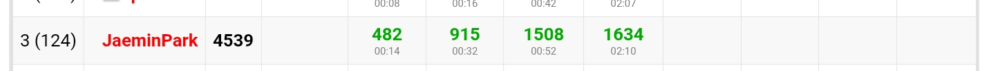

# Codeforces Round 1053 (Div. 1)

[https://codeforces.com/contest/2150](https://codeforces.com/contest/2150)

{: .center style="width:100%;"}

## A. Incremental Path

만약 방문한 마지막 칸의 색을 검정색으로 칠하는 업데이트가 없었다면 $i+1$번째 사람은 $i$번째 사람이 왔던 길을 그대로 간 후, 마지막에 새로운 행동을 하는 형태일 것이다.
마지막 칸의 색을 검정색으로 칠하는 업데이트가 $i+1$번째 사람의 이동 경로에 어떤 변화를 줄지 생각해보면, 적어도 그 업데이트된 칸에 도착하기 전까지인 $i-1$번째 행동까지는 똑같이 따라함을 알 수 있다.
마지막 행동이 `A`인 경우 $i+1$번째 사람은 $i$번째 행동 후 위치가 $i$번째 사람과 동일하고, `B`일 경우 $i$번째 행동 후 마지막으로 도착한 칸 바로 다음으로 등장하는 흰색 칸으로 이동하면 된다.
결론적으로, 최종 도착 위치는 계속 증가하고 검은색 칸들을 건너뛰기만 하면 되니 검은색 칸들의 배열에서 투 포인터로 선형 시간에 해결할 수 있다.

## B. Grid Counting

$k=1$일 때 두 조건을 모두 이용하면 $(1, 1), (1, N)$는 선택되어야 한다.
$k=2$일 때 두 조건과 $k=1$에서의 선택을 고려하면 $(1, 2), (2, 2)$ 중 하나, $(1, N-1), (2, N-1)$ 중 하나는 선택되어야 한다.
$k=3$일 때 두 조건과 $k=1, 2$에서의 선택을 고려하면 $(1, 3), (2, 3), (3, 3)$ 중 하나, $(1, N-2), (2, N-2), (3, N-2)$ 중 하나는 선택되어야 한다.
위와 같은 이유로, 다음과 같은 관찰을 할 수 있다.
$y$번째 열에서는 한 칸만 선택될 수 있으며, 그 행 번호 $x$는 $x \le \min(y, N-y+1)$를 만족한다.

우리는 행별로 선택해야 하는 칸들이 정해져 있는 상태인데, $N$번째 행부터 감소하는 순서대로 생각하자.
위 관찰에서 점점 선택할 수 있는 열의 범위는 확대되기만 하는 형태이니 지금까지의 선택을 모두 고려했을 떄 현재 내가 선택할 수 있는 열들의 수가 이전까지의 선택에 무관하게 결정된다.
따라서 단순 조합의 곱으로 계산할 수 있다.

## C. Limited Edition Shop

Alice가 선택 가능한 물건들의 집합에 대한 관찰을 하자.
편의를 위하여, 각 물건의 선호도 점수를 2차원 좌표평면에 플로팅하고 시작하자. (좌표가 큰 물건을 더 선호)
Alice와 Bob의 행동은 $x$좌표가 최대인 물건을 Alice가 선택하거나 $y$좌표가 최대인 물건을 Bob이 선택하는 것임을 알 수 있다.
이는 좌표평면에서 다음 그림과 같이 오른쪽이나 위에 붙어있는 직사각형 영역을 선택하는 행동과 같으며, 최종 Alice의 선택 범위는 오른쪽 위를 향하는 계단 모양의 경계선에서 아래쪽 영역이 된다.

그림1

이제, 위 관찰을 그대로 $dp[i][j]:=$ 계단이 $(i, j)$ 까지 올라왔을 때 Alice의 점수 최댓값으로 정의하면 $O(N^2)$에 문제를 해결할 수 있다.
이제 $i$를 고정하고 $A_i[j]=dp[i][j]$에서 시작하여 $A_{i+1}[j]=dp[i+1][j]$를 만들어내기 위하여 어떤 변화를 주어야 하는지 생각해보자.
$O(N^2)$ 풀이의 점화식을 생각하면 $A_i$에 해주어야 하는 업데이트는 1. 배열 전체에 prefix maximum 취하기, 2. suffix에 가중치 더하기 업데이트이다.
순서를 조금 바꾸어 생각하면 단조증가하는 배열 $A_i$에서 1. suffix에 가중치 더하기 업데이트, 2. prefix maximum 취하기 와 같다.
배열 $A_i$의 차이값 배열을 map으로 관리한다고 생각하면 suffix 덧셈 업데이트는 쉽게 해결할 수 있다.
Prefix maximum 취하는 것이 가중치가 음수일 때는 시간이 오래 걸릴 수도 있는데, 이는 차이값 배열에서 방금 업데이트한 칸에서 시작하여 연속한 몇개의 칸을 0으로 만드는 행동과 같으니 단순하게 순회하며 map에서 제거해주면 ammortized $O(N \log N)$에 문제를 해결할 수 있다.

그림2

## D. Attraction Theory

우선 연산을 원하는대로 수행했을 때 가능한 각 칸별 사람들의 수 $b[i]$에 대한 관찰을 하자.
0이 아닌 칸들은 연속한 구간을 이루어야 하며, 양쪽 끝칸을 제외한 남은 칸들은 $b[i]$가 홀수면 된다.
초기상태는 위 조건을 만족하고, 위 조건에 연산을 1회 적용해도 조건이 유지되니 귀납법으로 필요조건은 증명할 수 있고, 충분조건은 왼쪽부터 $b[i]$를 하나씩 만들어 나간다고 생각하면 항상 구성할 수 있음을 알 수 있다.

이제 위 조건을 만족하는 모든 $b[i]$들에 대하여 $\sum a[i] \cdot b[i]$의 합을 구하는 문제가 된다.
$b[i]$ 배열에서 0이 아닌 칸들의 길이 $K$와 양쪽 끝칸의 홀짝성을 고정하고 $b[i]$ 배열에서 0이 아닌 칸들을 모아 놓은 배열을 $c[i]$라 할 때, 가능한 모든 $c[i]$를 만드는 방법에 대해 생각해보자.
$c[i]$는 각 칸의 홀짝성에 따라 무조건적으로 가져야 하는 최솟값이 정해지고, 그 외에는 합을 $N$을로 만들기 위해 남은 짝수개의 가중치를 2개씩 묶어서 임의의 칸에 분배해야 한다 (그 횟수를 $R$라 하자).
예를 들어 $N=10$, $c[i]$가 길이는 $4$, 양쪽 끝 칸이 짝수인 배열로 고정했으면 최솟값 배열 $[2, 1, 1, 2]$에 임의의 칸에 $2$를 더하는 작업을 합이 $N=10$이 될때까지 반복하면 된다.
이제 이 최솟값 배열이 답에 미치는 영향과 마지막의 더하기 작업이 답에 미치는 영향을 나누어 생각하자.

최솟값 배열이 답에 미치는 영향은 비교적 쉽게 계산할 수 있다.
예를 들어 $N=10$, 최솟값 배열이 $[1, 1, 1, 1]$이면 이 배열 $c[i]$를 왼쪽부터 오른쪽으로 한 칸씩 밀면서 $a[i]$가 답에 더해지는 횟수를 생각하면 $[1, 2, 3, 4, 4, 4, 4, 3, 2, 1]$와 같이, $x=\sum a[i] \cdot min(i, N-i+1, K, N-K+1)$의 형태로 나타난다.
이는 $K$가 하나씩 커질 때 $a[i]$의 prefix sum과 suffix sum을 적당히 더해 구할 수 있다.
또한, 양쪽 끝 값이 짝수일 때도 비슷한 방법으로 빠르게 구할 수 있다.
이 값에 나머지 더하기 작업의 경우의 수 ${}_K H_R$를 곱하면 최솟값 배열이 답에 미치는 영향을 구할 수 있다.

이제 마지막의 더하기 작업들이 답에 미치는 영향을 생각하자.
길이 $N$의 배열에서 길이 $K$의 부분배열을 선택하고, 거기에서 한 칸에 2를 더하는 작업을 $R$번 반복하면 된다.
하지만 각 칸이 선택에 관여되는 횟수는 위에서 구한 $x$와 같으니, 풀어야 할 문제는 길이 $K$의 배열에서 한 칸에 2를 더하는 작업을 $P$번 반복하는 모든 경우의 수에 대하여 각 칸에 더해지는 값들의 합을 구하면 된다.
이는 모든 칸들에 대하여 같은 값이며, $y=2 \displaystyle \sum_{i=0}^{R} {}_{K-1} H_{R-i} \cdot i$이다.
이 식을 그냥 계산하면 $O(N^2)$ 풀이를 얻을 수 있다.

$$
\displaystyle \sum_{i=0}^{r} {}_{n} H_{r-i} \cdot i = r \cdot {}_{n+r} C_r - n \cdot {}_{n+r} C_{r-1}
$$

위 일반식을 이용하면 마지막 수식을 $O(1)$에 계산할 수 있고, 따라서 전체 문제를 $O(N)$에 해결할 수 있다.

## E1. Hidden Single (Version 1)

초기 상태에서 배열을 절반으로 나누어 $S_L$, $S_R$이라 하고, 모든 원소에 대해 $S_L$, $S_R$ 각각에 속하는지 여부를 물어본다고 가정하자.
어떤 원소가 $S_L$, $S_R$에 모두 속하면 확실히 2개 존재하는 원소이다.
확실히 2개 존재하는 원소를 모두 제거하고 나면 $S_L$에만 속하는 원소들과, $S_R$에만 속하는 원소들이 남는다.
이 때 $S_L$과 $S_R$ 중 하나는 홀수 크기여야 하는데, 답은 홀수 크기 집합에 속해야 한다.
이와 같이, $2N$번의 쿼리를 이용하여 후보 집합을 절반으로 줄이는데 성공했다.

하지만 $S_L$, $S_R$에 모두 속하는 원소들의 정확한 위치를 알지는 못하기 때문에 단순하게 위 과정을 재귀적으로 반복해서는 답을 구할 수 없다.
따라서, 답이 아니라는 것을 아는 원소들에 대해서도 바로 배제하는 것이 아니라 재귀를 함에 따라 쿼리를 소비하여 왼쪽, 오른쪽 중 어느 집합에 속하는지 알아야 한다.

$A:=$ 구간에 모두 포함되는 원소들, $B:=$ 구간 안에 1개, 구간 밖에 1개 포함되는 원소들, $C:=$ 구간 밖에 모두 포함되는 원소들로 나누어 생각하자.
구간을 줄여 나감에 따라 원소들은 처음에 $A$에서 시작하여 $B$로, 이후에는 $C$로 이동하게 된다.
결국 마지막에 $A$에 남은 한 원소가 답이 된다.
한 단계에서는 구간을 반으로 나누어 $S_L$, $S_R$이라 하자.

$A$의 원소 $a$에 대하여, $S_L$, $S_R$ 각각에 대하여 확인한다.

- $a$가 $S_L$, $S_R$에 모두 속한다.
- $a$가 $S_L$에만 속한다.
- $a$가 $S_R$에만 속한다.

$B$의 원소 $b$에 대하여, $S_L$에 대해서만 확인하면 구간 안에 하나만 있음이 확실하니 $S_R$에 대해서도 알 수 있다.

- $b$가 $S_L$에만 속한다.
- $b$가 $S_R$에만 속한다.

$A$에 속하는 원소가 2개라고 가정하고 $S_L$, $S_R$에 원소들을 분류하면, 결국 $A$에 속하는 하나짜리 원소 (정답) 때문에 $S_L$, $S_R$ 중 한군데에서 모순이 발생할 것이다.
정답이 속하는 칸은 바로 그곳이고, 모든 원소를 $A$, $B$, $C$ 로 완벽하게 분류하여 다시 재귀를 반복하면 된다.

한 구간에서 사용하는 쿼리의 수는 $2|A| + |B|$인데, 이는 구간에 정답을 제외한 $A$의 원소들은 2개씩, $B$의 원소들은 1개씩 있으니 정답에 해당하는 원소만 한번 더 세어져 구간의 길이 + 1과 같다.
따라서 전체 사용하는 쿼리의 수는 $f(n)=f(\lceil \frac{n}{2} \rceil)+1$이다.
$2N+N+\frac{N}{2} + \cdots \le 4N$, 올림 연산에서 발생하는 $\lceil \log N \rceil$, 추가적인 +1에서 발생하는 $\lceil \log N \rceil$로 전체 $4N + 2\lceil \log N \rceil$이다.

## E2. Hidden Single (Version 2)

E1과의 차이점과, 문제 세팅상 랜덤을 활용해야 할것으로 보인다.
E1에서 가장 직관적이었고, 가장 효율적으로 후보의 수를 절반으로 줄였던 첫 번째 단계를 다시 생각해보자.
$S_L$, $S_R$을 랜덤하게 분할하고, 각 원소를 $S_L$부터 속하는지 여부를 물어본다.

- 만약 $S_L$에 존재하지 않는다면 무조건 $S_R$에 존재하니, 물어볼 필요도 없다.
    $S_R$에만 존재할 확률은 $\frac{1}{4}$로, 1번의 쿼리만 필요하다.
- $S_L$에 존재한다면, $S_R$도 확인해봐야 한다.
    - $S_L$에만 존재할 확률은 $\frac{1}{4}$로, 2번의 쿼리가 필요하다.
    - $S_L$, $S_R$에 모두 존재할 확률은 $\frac{1}{2}$로, 2번의 쿼리가 필요하다.

각 원소당 $\frac{1}{4} \cdot 1 + \frac{1}{4} \cdot 2 + \frac{1}{2} \cdot 2 = \frac{7}{4}$의 기댓값, 즉 전체 $\frac{7}{4}N$번의 쿼리로 후보 집합을 $S_L$이나 $S_R$로 줄일 수 있는데, 이 때 후보집합의 크기의 기댓값은 $\frac{1}{4}N$이 된다.

이제 이전처럼 재귀하는 대신 더 랜덤을 활용해서 간단하게 후보 집합의 수를 줄일 수는 없을까?
첫 번째 단계의 아이디어를 다시 활용해서, 만약 $S_L$, $S_R$에 모두 존재한다면 확실히 후보 집합에서 제거할 수 있을 것이다.
대신, 후보 집합의 원소들에 대해서만 쿼리해서는 $S_L$, $S_R$ 중 정답이 포함된 집합을 골라내지는 못한다. (E1에서 정확히 같은 문제에 부딪혔었다.)
E1에서는 이를 후보 집합에 포함되지 않은 원소들에 대해서도 상태를 관리함으로써 해결했지만, 이번에는 후보 집합에 포함된 원소들에 대해서만 쿼리하는 대신 $S_L$, $S_R$에 모두 존재할 때만 제거하는 선택을 해보자.

한 단계에서, 후보 집합에 속한 원소 하나에 대하여 가능한 경우의 수는 다음과 같다.

- 만약 $S_L$에 존재하지 않는다면 무조건 $S_R$에 존재하니, 물어볼 필요도 없다.
    $S_R$에만 존재할 확률은 $\frac{1}{4}$로, 1번의 쿼리로 후보 집합에 유지시킨다.
- $S_L$에 존재한다면, $S_R$도 확인해봐야 한다.
    - $S_L$에만 존재할 확률은 $\frac{1}{4}$로, 2번의 쿼리로 후보 집합에 유지시킨다.
    - $S_L$, $S_R$에 모두 존재할 확률은 $\frac{1}{2}$로, 2번의 쿼리로 후보 집합에서 제거한다.

$$E = \frac{1}{4}(1+E) + \frac{1}{4}(2+E) + \frac{1}{2} \cdot 2$$

따라서, 각 원소별 후보집합에서 제거되기까지 필요한 쿼리의 횟수 $E=\frac{7}{2}$이다.
처음부터 모든 원소를 후보집합에 넣고 시작하면 $\frac{7}{2}N$이지만, 위에서 계산한 첫 단계의 힘을 최대한 활용하면 $\frac{7}{4}N$번의 쿼리로 $\frac{1}{4}N$ 크기의 후보집합에서 시작할 수 있다.
이 경우 $\frac{7}{4}N + \frac{1}{4}N \cdot \frac{7}{2}=\frac{21}{8}N$으로 절약할 수 있다.
첫 단계에서 후보집합이 전체집합임을 이용하여 후보집합을 $S_L$, $S_R$ 중 하나로 선택할 수 있다는 점에서 다른 단계들과는 절약이 발생한 것이다.

## F. Cycle Closing

입력 그래프가 트리일 때에 대해서만 풀어도 된다. (스패닝 트리를 생각하자.)
우선, 입력 그래프가 직선일 때가 그렇게 자명하지 않으니 먼저 풀어보자.

1. 길이 2의 경로들을 모두 추가한다.
2. 원래 직선에서 3이상 떨어져 있던 임의의 두 정점 $u, v$에 대하여 다음과 같이 모든 정점을 다 지나는 경로를 만들어낼 수 있다.
    왼쪽 정점에서 시작하여, 가장 왼쪽까지 갈 때까지 2칸씩 뛰어넘으며 이동한다.
    더이상 이동할 수 없을 때 다시 시작 정점을 뛰어넘을 때까지 2칸씩 뛰어넘으며 이동한다.
    오른쪽 정점에서도 같은 행동을 하고 나면, 가운데 정점들은 한칸씩 이어주면 된다.

직선일 때의 답을 바탕으로 트리에서도 정점 개수 $3$, $N$로 해결할 수 있을 것이라고 생각할 수 있지만, 트리일 때는 길이 1, 2의 간선들만을 이용하여 모든 정점을 한번씩만 지나는 해밀턴 경로를 만들 수 없다.

대신, 직선일 때 정점 개수 $N$인 경로를 만들었다는 점에서 트리일 때는 지름의 정점의 수 $D$를 활용하겠다는 아이디어를 생각해볼 수 있다.
대부분의 경우에 문제없이 해결할 수 있지만, 정점 $u, v$에서 가장 가까운 지름에 포함되는 정점 $u', v'$이 1칸 차이날 때를 해결할 수가 없다.
직선 그래프의 경우에는 애초에 $u', v'$가 3이상 떨어져 있던 경우에 대해서만 생각했기 때문에 이러한 문제가 발생하지 않았다.

정답은 정점 개수 $3$, $K = \lfloor \frac{D}{2} \rfloor + 1$개를 선택하는 것이다.
사실 직선일 때도 $N$개를 다 쓰지 않고 필요할 때는 2칸씩 뛰어넘으면 $\lfloor \frac{N}{2} \rfloor + 1$개로도 충분하다.

- $d(u, v)+1 \ge K$ : 필요할 때 2칸씩 뛰어넘으면 $K$개 정점으로 무조건 $u$에서 $v$로 도착할 수 있다는 보장이 있기 때문에 (지름의 성질) 해결할 수 있다.
- $d(u, v)+1 < K$ : 이제는 정점을 낭비해야 하는 입장이고, $D$개를 써야 했던 아까의 상황과 동일하다.
    다만, 이제는 정점 $u, v$에서 가장 가까운 지름에 포함되는 정점 $u', v'$이 1칸 차이날 때에도 왼쪽이나 오른쪽 중 더 긴쪽을 선택하면 $\lfloor \frac{D}{2} \rfloor + 1$는 충분히 낭비할 수 있기 때문에 아까의 문제가 해결된다.

구현이 매우 복잡한데, 지름에 대해서 $a$번째 정점에서 $b$번째 정점으로 길이 1, 2의 간선들만을 이용하여 이동하는 길이 $k$의 경로를 구해주는 함수 $f(a, b, k)$를 구현하면 비교적 편하게 구현할 수 있다.

## G. Counting Is Fun: The Finale

우선 binary string이 주어졌을 때 longest non-decreasing subsequence의 길이가 $k$보다 크거나 같을 조건을 구해보자.
binary string에서 일반적으로 생각하는 0에서는 $+1$, 1에서는 $-1$을 하며 만들어진 산 모양 그림을 생각하자.
0의 개수를 $x$, 1의 개수를 $y$, 누적합의 최솟값을 $min$이라 한다면 longest non-decreasing subsequence의 길이는 $y-min$과 같다.
즉, 우리가 원하는 조건은 $y-min \ge k$, 다시 말해 $min \le y-k$이다.

이제, 0 $x$개, 1 $y$개, longest non-decreasing subsequence의 길이의 하한값 $k$가 주어졌을 때 조건을 만족하는 수열의 개수 $f(x, y, k)$를 구해보자.
$min \le -1$인 것들을 제거하는 카탈란 수 일반식에서의 논리와 같이, 이번에도 하한선 $y-k$를 기준으로 도착점 $y$를 대칭시켜 $x+y-2k$로 향하도록 하는 경우의 수와 우리가 구하고자 하는 경우의 수가 일대일 대응된다.
시작점 $0$과 끝점 $y-x$에서 이미 조건을 만족하는 경우인 $0 \le y-k$, $y-x \le y-k$만 제외하면 위 대칭 논리로 구할 수 있는 경우의 수 ${}_{x+y} C_{k}$가 된다.
전체 길이보다 $k$가 긴 경우는 당연히 불가능하니 경우의 수가 $0$이다.
정리하자면 $f(x, y, k)$는 다음과 같이 구할 수 있다.

- $x \ge k$ or $y \ge k$ : ${}_{x+y} C_{x}$
- $x+y < k$ : $0$
- otherwise : ${}_{x+y} C_{k}$

lexicographic 관련된 문제를 풀어야 하니, prefix가 정해진 상태에서도 비슷한 경우의 수를 계산할 수 있어야 한다.
prefix에서 0 $X$개, 1 $Y$개, min값 $Z$일 때 0 $x$개, 1 $y$개를 뒤에 붙혀 longest non-decreasing subsequence의 길이를 $k$ 이상으로 만드는 수열의 개수 $g(x, y, X, Y, Z, k)$를 구해보자.
우선 시작점과 끝점에서 이미 조건을 만족하는 경우와 아에 불가능한 경우를 모두 고려한다.
그 외 경우는 $f(x, y, k)$와 같은 방법으로 하한선에서의 대칭 논리를 활용하면 경우의 수가 ${}_{x+y} C_{k-X}$가 된다.
정리하자면 $g(x, y, X, Y, Z, k)$는 다음과 같이 구할 수 있다.

- $X+x \ge k$ or $Y-Z+y \ge k$ : ${}_{x+y} C_{x}$
- otherwise, $X+x+y < k$ : $0$
- otherwise : ${}_{x+y} C_{k-X}$

우리가 원하는 조건은 $\text{lnds}(b_1 b_2 \dots b_i) \ge k, \text{lnds}(b_{i+1} b_{i+2} \dots b_{x+y}) \ge k$이니, $i$의 선택에 대한 고민을 없애기 위해 그리디하게 $i$는 조건을 만족하는 최소 인덱스로 정의하자.
즉, $\text{lnds}(b_1 b_2 \dots b_i)=k$, $b_i=0$, $\text{lnds}(b_1 b_2 \dots b_{i-1})=k-1$을 만족한다.

이제 답을 구하기 위해 고려하고 있는 수열 $b$와 주어진 수열 $a$의 LCP 길이 + 1 (고정되는 prefix의 길이) $p$, 또 조건을 만족하는 최소 인덱스 $i$를 고정하자.
$i \le p$인 경우, 앞쪽 수열은 정해져버리니 조건을 만족하는지 확인하고, 뒤쪽 수열에 대해서는 위에서 만든 $g(x, y, X, Y, Z, k)$를 그대로 활용하면 된다.
$i > p$인 경우가 어려운데, 앞쪽 수열에 배분할 0의 개수, $c$를 정해야 한다.
이 값만 정하면 자동으로 앞쪽 수열의 0, 1 개수와 뒤쪽 수열의 0, 1 개수가 정해진다.
뒤쪽 수열의 경우는 $f(x, y, k)$를 그대로 활용하면 된다.
앞쪽 수열의 경우 $\text{lnds}(b_1 b_2 \dots b_{i-1})=k-1$을 만족해야 하니 $g(x, y, X, Y, Z, k-1) - g(x, y, X, Y, Z, k)$로 구할 수 있다.
$i$, $p$를 고정해야 하고, $i > p$인 경우 앞쪽 수열에 배분할 0의 개수를 정해야 하기 때문에 전체 $O(N^3)$에 문제를 해결할 수 있다.

$g(x, y, X, Y, Z, k)$가 생각보다 단순하다는 점을 고려했을 때, $g(x, y, X, Y, Z, k-1) - g(x, y, X, Y, Z, k)$가 0이 아닌 값을 가질 조건에 대해서 생각해보자.
$X+x \ge k$ or $Y-Z+y \ge k$ : Case 1, otherwise : Case 2 라고 할 때, $g(x, y, X, Y, Z, k-1)$과 $g(x, y, X, Y, Z, k)$를 Case에 따라 분류하자.

- $g(x, y, X, Y, Z, k-1) \rightarrow$ Case 1, $g(x, y, X, Y, Z, k) \rightarrow$ Case 1 :  
    $g(x, y, X, Y, Z, k-1) - g(x, y, X, Y, Z, k) = 0$
- $g(x, y, X, Y, Z, k-1) \rightarrow$ Case 1, $g(x, y, X, Y, Z, k) \rightarrow$ Case 2 :  
    부등식의 경계선에 걸리는 $x, y$는 $X+x = k$ or $Y-Z+y = k$ 단 2개밖에 없으니, 계산해도 된다.
- $g(x, y, X, Y, Z, k-1) \rightarrow$ Case 2, $g(x, y, X, Y, Z, k) \rightarrow$ Case 2 :  
    $g(x, y, X, Y, Z, k-1) - g(x, y, X, Y, Z, k) = C$, $x, y$와 관계없이 상수이다.
    뒤쪽 수열로 곱할 $f(x, y, K)$를 $x$에 대한 배열로 만들어 두면 단순 누적합과 $C$의 곱을 통해 빠르게 계산할 수 있다.

위 관찰을 통해 $i$, $p$만 고정하면 $O(1)$에 해결할 수 있으니, $O(N^2)$에 답을 구할 수 있다.